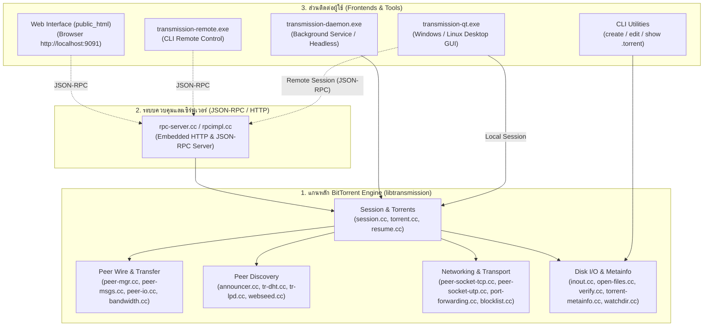

# โครงสร้างระบบและคู่มือการพัฒนา Transmission (ฉบับภาษาไทย)

เอกสารนี้สรุปสถาปัตยกรรม โครงสร้างซอร์สโค้ด โมดูลย่อยทั้งหมด รวมถึงขั้นตอนการ Compile และใช้งานโปรเจกต์ **Transmission (`4.2.0-dev`)** บนระบบปฏิบัติการ Windows

---

## 1. ภาพรวมสถาปัตยกรรมระบบ (System Architecture)

Transmission แบ่งโครงสร้างออกเป็น **3 ชั้นหลัก** ได้แก่:
1. **Core Engine (`libtransmission` & `libtransmission-app`)** — แกนหลักโปรโตคอล BitTorrent, ระบบเครือข่าย, การอ่าน-เขียนไฟล์ และ JSON-RPC Server
2. **Remote Control & Web Layer (`RPC & Web UI`)** — ส่วนควบคุมระยะไกลผ่านโปรโตคอล HTTP/JSON-RPC และเว็บแอปพลิเคชัน
3. **Frontends & CLI Tools (`qt`, `daemon`, `utils`, `gtk`, `macosx`, `cli`)** — ส่วนติดต่อผู้ใช้ทั้งแบบ Desktop GUI, Background Service และ Command Line



---

## 2. รายละเอียดโมดูลในแกนหลัก (`libtransmission/`)

โฟลเดอร์ [`libtransmission/`](libtransmission/) คือหัวใจหลักของโปรแกรม (สร้างเป็นไลบรารี `libtransmission.a`) ประกอบด้วยระบบย่อยดังนี้:

### 2.1 การจัดการเซสชันและทอร์เรนต์ (Session & Torrent Management)
| ไฟล์ | หน้าที่การทำงาน |
| :--- | :--- |
| `session.cc` / `session.h` | จัดการวงจรการทำงานหลักของโปรแกรม, โหลด/บันทึก `settings.json`, ควบคุมพอร์ต และ Event Loop (`libevent`) |
| `session-thread.cc` | รัน Event Loop ของ `libtransmission` บน Thread แยกเพื่อไม่ให้บล็อก UI |
| `torrent.cc` / `torrent.h` | จัดการสถานะของแต่ละทอร์เรนต์ (Downloading, Seeding, Paused, Verifying, Queued) |
| `torrents.cc` / `torrents.h` | คลังเก็บรายการทอร์เรนต์ทั้งหมดในเซสชัน พร้อมการค้นหาด้วย ID หรือ Info Hash |
| `torrent-ctor.cc` | ตัวสร้างออบเจกต์ทอร์เรนต์จากไฟล์ `.torrent` หรือลิงก์ Magnet |
| `torrent-queue.cc` | ระบบจัดคิวลำดับการดาวน์โหลดและ Seeding |
| `resume.cc` / `resume.h` | บันทึกและโหลดไฟล์ `.resume` เพื่อจำสถานะชิ้นส่วนไฟล์ที่โหลดค้างไว้ |
| `stats.cc` / `stats.h` | เก็บสถิติยอดการดาวน์โหลด/อัปโหลดสะสม และอัตราส่วน (Ratio) |

### 2.2 การรับ-ส่งข้อมูลและจัดการ Peers (Peer Wire & Bandwidth)
| ไฟล์ | หน้าที่การทำงาน |
| :--- | :--- |
| `peer-mgr.cc` / `peer-mgr.h` | บริหารการเชื่อมต่อกับ Peers ทั้งหมด, การเลือกชิ้นส่วนไฟล์ (Piece Selection), และอัลกอริทึม Choke/Unchoke |
| `peer-mgr-wishlist.cc` | จัดลำดับความสำคัญของชิ้นส่วนไฟล์ (Pieces/Blocks) ที่ต้องการดาวน์โหลดก่อน |
| `peer-msgs.cc` / `peer-msgs.h` | รับ-ส่งข้อความตามมาตรฐาน BitTorrent Peer Wire Protocol |
| `peer-io.cc` / `peer-io.h` | จัดการบัฟเฟอร์การอ่าน/เขียนข้อมูลผ่าน Socket กับ Peer แต่ละตัว |
| `handshake.cc` / `handshake.h` | กระบวนการจับมือเริ่มต้น (BitTorrent Handshake) และการตรวจสอบ Info Hash / Peer ID |
| `peer-mse.cc` / `peer-mse.h` | การเข้ารหัสกระแสข้อมูล (Message Stream Encryption / Protocol Encryption) |
| `bandwidth.cc` / `bandwidth.h` | ระบบควบคุมและจำกัดความเร็วดาวน์โหลด/อัปโหลดทั้งระดับทอร์เรนต์และระดับเซสชัน |
| `session-alt-speeds.cc` | ระบบจำกัดความเร็วสำรองตามตารางเวลา (Alternative Speed Limits / Turtle Mode) |
| `clients.cc` / `clients.h` | แปลงรหัส Peer ID (เช่น `-TR420Z-`) เป็นชื่อโปรแกรมบิตทอร์เรนต์ของฝั่งตรงข้าม |

### 2.3 การค้นหาผู้ปล่อยไฟล์ (Trackers & Peer Discovery)
| ไฟล์ | หน้าที่การทำงาน |
| :--- | :--- |
| `announcer.cc` / `announce-list.cc` | ระบบจัดการรายชื่อ Trackers, รอบเวลาการ Announce/Scrape และการส่งสถิติ Upload/Download |
| `announcer-http.cc` | การติดต่อ Tracker ผ่านโปรโตคอล HTTP / HTTPS (ใช้ `libcurl`) |
| `announcer-udp.cc` | การติดต่อ Tracker ผ่านโปรโตคอล UDP |
| `tr-dht.cc` / `tr-dht.h` | ระบบ **DHT (Distributed Hash Table)** ค้นหา Peers แบบไร้ศูนย์กลางโดยไม่ต้องใช้ Tracker |
| `tr-lpd.cc` / `tr-lpd.h` | ระบบ **LPD (Local Peer Discovery)** ค้นหาผู้ใช้งานที่โหลดไฟล์เดียวกันในวง LAN |
| `bep55-holepunch.cc` | ระบบช่วยเชื่อมต่อผ่าน NAT (Holepunching extension ตามมาตรฐาน BEP 55) |
| `webseed.cc` / `webseed.h` | ดาวน์โหลดชิ้นส่วนไฟล์จาก HTTP/FTP Server โดยตรง (WebSeeds ตาม BEP 19) |

### 2.4 ระบบเครือข่ายและความปลอดภัย (Networking & Security)
| ไฟล์ | หน้าที่การทำงาน |
| :--- | :--- |
| `net.cc` / `net.h` | จัดการที่อยู่ IP (IPv4/IPv6), การสร้าง Socket และการตั้งค่า DSCP/TOS |
| `peer-socket-tcp.cc` | การเชื่อมต่อรับ-ส่งข้อมูลผ่าน TCP |
| `peer-socket-utp.cc` / `tr-utp.cc` | การเชื่อมต่อผ่านโปรโตคอล **µTP (Micro Transport Protocol)** บน UDP |
| `port-forwarding.cc` | ระบบจัดการการเปิดพอร์ตเร้าเตอร์อัตโนมัติ |
| `port-forwarding-upnp.cc` | เปิดพอร์ตผ่านมาตรฐาน UPnP IGD (ใช้ `miniupnpc`) |
| `port-forwarding-natpmp.cc` | เปิดพอร์ตผ่านมาตรฐาน NAT-PMP / PCP (ใช้ `libnatpmp`) |
| `blocklist.cc` / `blocklist.h` | ระบบกรองและบล็อกหมายเลข IP ตามรายการ Blocklist |
| `crypto-utils.cc` / `crypto-utils-openssl.cc` | ฟังก์ชันคำนวณ SHA-1, การสุ่มตัวเลข และการเข้ารหัสผ่าน OpenSSL |

### 2.5 ระบบดิสก์ ข้อมูลเมตา และไฟล์ระบบ (Disk Storage & Metainfo)
| ไฟล์ | หน้าที่การทำงาน |
| :--- | :--- |
| `inout.cc` / `inout.h` | อ่านและเขียนข้อมูลแต่ละ Block/Piece ลงไฟล์จริงในฮาร์ดดิสก์ |
| `open-files.cc` / `open-files.h` | แคชของ File Descriptors ที่เปิดอยู่เพื่อลดการสั่งเปิด-ปิดไฟล์ซ้ำ ๆ |
| `verify.cc` / `verify.h` | ตรวจสอบความถูกต้องของไฟล์ในดิสก์เทียบกับค่า SHA-1 Hash ของแต่ละ Piece |
| `completion.cc` / `bitfield.cc` | คำนวณเปอร์เซ็นต์ความคืบหน้าและเก็บตาราง Bitfield ของชิ้นส่วนที่โหลดเสร็จแล้ว |
| `torrent-metainfo.cc` | อ่านและแปลงโครงสร้างไฟล์ `.torrent` |
| `magnet-metainfo.cc` | แยกวิเคราะห์ลิงก์ Magnet (`magnet:?xt=urn:btih:...`) |
| `makemeta.cc` / `makemeta.h` | สร้างไฟล์ `.torrent` ใหม่จากไฟล์หรือโฟลเดอร์ |
| `variant.cc` / `variant-benc.cc` / `variant-json.cc` | ตัวแปลงโครงสร้างข้อมูลระหว่าง C++ Variant, Bencode และ JSON |
| `watchdir.cc` / `watchdir-win32.cc` | เฝ้าดูโฟลเดอร์ที่กำหนดเพื่อนำเข้าไฟล์ `.torrent` อัตโนมัติทันทีที่มีไฟล์ใหม่ถูกวาง |

---

## 3. ระบบ JSON-RPC และ Web Interface

* **`libtransmission/rpc-server.cc` & `libtransmission/rpcimpl.cc`**
  * สร้าง HTTP Server ในตัว (ค่าเริ่มต้นพอร์ต `9091`)
  * รับคำสั่ง JSON-RPC ที่ `/transmission/rpc` (เช่น `torrent-add`, `torrent-start`, `torrent-stop`, ` torrent-get`, `session-set`)
  * รายละเอียดสเปกของ API ทั้งหมดดูได้ที่ [`docs/rpc-spec.md`](docs/rpc-spec.md)
* **`web/` (`web/src/` และ `web/public_html/`)**
  * หน้าเว็บควบคุมของ Transmission ที่เขียนด้วย JavaScript/CSS สมัยใหม่ ไม่พึ่งพาเฟรมเวิร์กหนัก ๆ
  * เมื่อเปิด `http://localhost:9091` ตัว `rpc-server.cc` จะเสิร์ฟไฟล์จากโฟลเดอร์ `public_html` ให้เบราว์เซอร์

---

## 4. ส่วนติดต่อผู้ใช้และเครื่องมือทั้งหมด (Frontends & Binaries)

| โปรแกรม / โฟลเดอร์โค้ด | ไฟล์ `.exe` ที่สร้างเสร็จ | ขนาด (Stripped) | หน้าที่และการใช้งาน |
| :--- | :--- | :---: | :--- |
| **Windows Qt GUI**<br>([`qt/`](qt/)) | `build/qt/transmission-qt.exe` | **6.07 MB** | **โปรแกรมหน้าต่าง GUI หลักบน Windows** ใช้โหลดบิตได้ในตัว (Local Session) หรือใช้เชื่อมต่อไปคุมเซิร์ฟเวอร์อื่น (Remote Session) |
| **Background Daemon**<br>([`daemon/`](daemon/)) | `build/daemon/transmission-daemon.exe` | **4.15 MB** | **เซอร์วิสโหลดบิตแบบไม่มีหน้าต่าง** รันด้วยคำสั่ง `transmission-daemon.exe -f` (หรือคลิก `start-daemon.bat`) แล้วควบคุมผ่านเว็บ `http://localhost:9091` |
| **CLI Remote**<br>([`utils/remote.cc`](utils/remote.cc)) | `build/utils/transmission-remote.exe` | **4.13 MB** | สั่งงาน `transmission-daemon` หรือ `transmission-qt` (ที่เปิด Web/RPC) ผ่าน Command Line |
| **Torrent Creator**<br>([`utils/create.cc`](utils/create.cc)) | `build/utils/transmission-create.exe` | **1.24 MB** | สร้างไฟล์ `.torrent` จากไฟล์หรือโฟลเดอร์ |
| **Torrent Inspector**<br>([`utils/show.cc`](utils/show.cc)) | `build/utils/transmission-show.exe` | **1.35 MB** | แสดงรายละเอียดข้อมูลข้างในไฟล์ `.torrent` หรือ Magnet link |
| **Torrent Editor**<br>([`utils/edit.cc`](utils/edit.cc)) | `build/utils/transmission-edit.exe` | **1.03 MB** | เพิ่ม/ลบ/แก้ไข URL ของ Tracker ในไฟล์ `.torrent` |

### โครงสร้างไฟล์สำคัญในส่วน GUI (`qt/`)
* [`qt/MainWindow.cc`](qt/MainWindow.cc) / [`qt/MainWindow.ui`](qt/MainWindow.ui) — หน้าต่างหลัก เมนู แถบเครื่องมือ และแถบสถานะ
* [`qt/TorrentDelegate.cc`](qt/TorrentDelegate.cc) / [`qt/TorrentDelegateMin.cc`](qt/TorrentDelegateMin.cc) — ตัววาดแต่ละแถวของรายการทอร์เรนต์ (ชื่อไฟล์, Ratio, หลอด Progress bar สีเขียว/ฟ้า)
* [`qt/TorrentModel.cc`](qt/TorrentModel.cc) / [`qt/TorrentFilter.cc`](qt/TorrentFilter.cc) — โมเดลข้อมูลทอร์เรนต์และระบบกรองตามสถานะ/หมวดหมู่/คำค้นหา
* [`qt/DetailsDialog.cc`](qt/DetailsDialog.cc) — หน้าต่างดูข้อมูลเชิงลึกของทอร์เรนต์ (แท็บ Activity, Peers, Trackers, Files, Options)
* [`qt/PrefsDialog.cc`](qt/PrefsDialog.cc) — หน้าต่างตั้งค่าโปรแกรม (Speed, Downloading, Seeding, Privacy, Network, Desktop, Remote)
* [`qt/Session.cc`](qt/Session.cc) / [`qt/RpcClient.cc`](qt/RpcClient.cc) — ตัวเชื่อมระหว่างหน้าจอ Qt กับ `libtransmission` (ทั้งแบบ Local และ Remote RPC)

---

## 5. วิธี Compile และอัปเดตไบนารีบน Windows (MSYS2 UCRT64)

### 5.1 การสั่ง Compile ใหม่เมื่อแก้ไขโค้ด (Incremental Build)
เปิด PowerShell ที่โฟลเดอร์โปรเจกต์ `D:\myproject1\transmission` แล้วรัน:

```powershell
$env:PATH = "C:\msys64\ucrt64\bin;C:\msys64\usr\bin;" + $env:PATH

# คอมไพล์ทุกเป้าหมาย (ใช้เวลาเพียงไม่กี่วินาทีสำหรับไฟล์ที่แก้ไข)
ninja -C build

# หรือคอมไพล์เฉพาะตัวหน้าต่าง GUI (transmission-qt.exe)
ninja -C build transmission-qt
```

### 5.2 การตัด Debug Symbols เพื่อลดขนาดไฟล์สำหรับใช้งานจริง (Strip)
```powershell
C:\msys64\ucrt64\bin\strip.exe --strip-all `
    "D:\myproject1\transmission\build\qt\transmission-qt.exe" `
    "D:\myproject1\transmission\build\daemon\transmission-daemon.exe" `
    "D:\myproject1\transmission\build\utils\transmission-remote.exe" `
    "D:\myproject1\transmission\build\utils\transmission-create.exe" `
    "D:\myproject1\transmission\build\utils\transmission-edit.exe" `
    "D:\myproject1\transmission\build\utils\transmission-show.exe"
```

### 5.3 คำสั่งตั้งค่า CMake ใหม่ตั้งแต่ต้น (กรณีต้องการล้างโฟลเดอร์ `build/`)
```powershell
$env:PATH = "C:\msys64\ucrt64\bin;C:\msys64\usr\bin;" + $env:PATH
cmake -B build -G Ninja `
    -DCMAKE_BUILD_TYPE=RelWithDebInfo `
    -DENABLE_DAEMON=ON `
    -DENABLE_QT=ON `
    -DUSE_QT_VERSION=6 `
    -DENABLE_UTILS=ON `
    -DENABLE_TESTS=OFF `
    -DENABLE_CLI=OFF `
    -DENABLE_NLS=OFF
ninja -C build
```
